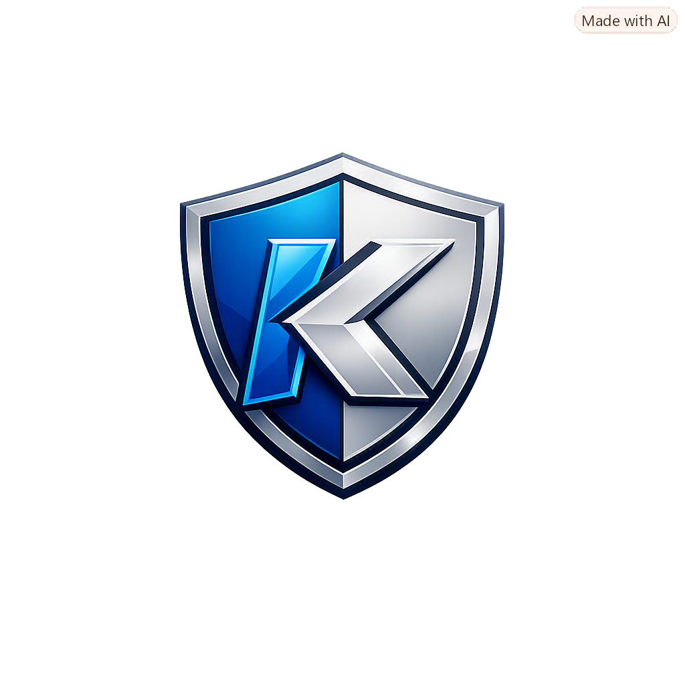

# K-Certificate Manager (K-인증서 매니저) v2.3.0

<div align="center">


**대한민국 공무원 행정전자서명(GPKI/EPKI) 및 금융 공동인증서(NPKI) 자동 탐색·USB 일괄 백업 & PC 역방향 복사 통합 보안 관리 솔루션**

[공식 블로그](https://ahbiyoutvibe.blogspot.com/) • [GitHub 저장소](https://github.com/AhBiYout-all/K-Certificate-Manager) • [소속 회사 (청운정보시스템)](https://www.cisnet.co.kr)

</div>

---

## 🚀 최신 릴리스 정보 (Latest Release: v2.3.0)

> **버전**: `v2.3.0` (Semantic Versioning 2.0.0 MINOR Release)  
> **출시일**: 2026-11-26  
> **상세 변경 내역**: [docs/PATCHNOTES.md](./docs/PATCHNOTES.md) • [GitHub 문서](./docs/GITHUB_DOCS.md) • [GitHub 배포 가이드](./docs/GITHUB_GUIDE.md) • [버전 관리 정책](./docs/VERSIONING_POLICY.md)

### 🌟 v2.3.0 핵심 업데이트 및 신규 기능
- **PC↔USB 양방향 통합 단일 전송 엔진 전면 신설 (`unifiedTransferEngine.ts`, `UnifiedTransferEngine.cs`)**:
  - `PC_TO_USB`, `USB_TO_PC`, `DISK_TO_DISK`, `USB_TO_USB` 4대 전송 방향을 **Phase 1 Dry-Run 실행 계획기(`TransferPlan`) ➔ Phase 2 원자적 일괄 실행기(`TransferExecutor`)** 단일 아키텍처로 통합
  - 복사 실행 전 자가 복사(`SKIP_SELF_COPY`), 다중 디스크 동일 대상 경로 병합(`SKIP_BATCH_DUPLICATE`), 기존 중복 충돌 전략(`overwrite` / `archive_old`·`rename` / `skip`)을 실시간 **"실행 계획 미리보기"**로 확정해 예측 건수와 실제 복사 결과를 100% 일치화
- **공유 폴더형 GPKI·EPKI 인증서 선택 파일 단위 격리 복사 완성 (`CertTransferEngine.cs`, `UnifiedTransferEngine.cs`, `unifiedTransferEngine.ts`, `backupService.ts`, `App.tsx`)**:
  - 여러 인증서가 공존하는 `GPKI\Certificate\class1|class2` 등 공유 폴더에서 1건만 선택 복사해도 폴더 전체가 복사되던 문제를 해결해, 선택된 `.cer/.der` · 매칭된 `.key/.pri` · 동일 접두사 동반 `_env`/`_km` 파일만 선별 전송·아카이빙·하이라이트 처리
- **다중 디스크 선택 복사 정합화 & 연결 디스크 우선순위 자동 정렬 (`ConnectedDrivesBar`, `BackupModal`, `MainViewModel`)**:
  - 이동식/외장 드라이브 장치 종류 및 드라이브 문자 기준 자동 우선순위 정렬 적용, `resolveSelectedBackupCerts` 교집합(`selectedIds ∩ visibleCertificates`) 엄격 격리 및 다중 디스크 실제 복사 ID(`copiedCertIds`) 1:1 정합화
- **저눈부심 회색(*Misty Mineral Slate*) · 베이지(*Warm Oat Paper*) 테마, 상단 창 드래그 & 5회+ 전수 감사 안정화**:
  - Tailwind v4 `@custom-variant dark`·WPF `DynamicResource`/`WpfAnimatedBorderHelper` 휘도 적응형 전 창 대비 통일, `Header.tsx` 네이티브 창 드래그(`app-region: drag/no-drag`), WPF `try/catch/finally`·`WasSkipped`·부분 실패 처리·`_backup_YYYYMMDD` 아카이빙 보강 및 `v2.2.0` 핵심 기능(3단계 비차단 스캔, RSA 3072-bit 보안강도 진단, 2026 인증 동향) 완전 계승

---

## 📌 프로젝트 소개 (Overview)

<div align="center">
  
</div>

**K-인증서 매니저 (K-Certificate Manager)**는 복잡하고 번거로운 대한민국 공인/공동인증서(NPKI), 정부 행정전자서명(GPKI), 교육부 전자서명(EPKI)을 한곳에서 안전하게 탐색하고 관리할 수 있도록 설계된 도구입니다.

- **표준 저장 경로 자동 스캔**: `AppData\LocalLow`, `C:\GPKI`, `C:\EPKI` 등 주요 시스템 경로 자동 인식
- **원클릭 USB 백업**: 선택한 인증서를 USB 메모리나 외장 드라이브의 표준 규격 폴더로 안전하게 복사
- **USB ➔ PC 역방향 가져오기**: USB에 저장된 인증서를 내 컴퓨터의 표준 보관함으로 원클릭 등록
- **SHA-256 무결성 검증**: 개인키(`signPri.key`)와 인증서(`signCert.der`)의 위변조 방지 및 트랜잭션 검증
- **듀얼 플랫폼 지원**: 최신 웹 브라우저 에디션(React + Vite) 및 Windows C# WPF 네이티브 데스크톱 에디션 제공

---

## ✨ 핵심 기능 (Key Features)

### 1. 전 규격 인증서 자동 탐색 및 식별
- **은행/신용카드/보험용 (NPKI)**: 금융결제원(yessign), 한국정보인증(KICA), 코스콤(SignKorea) 등
- **공무원 행정전자서명 (GPKI)**: 정부24, 온-나라 시스템, 행정안전부 행정기관용 인증서
- **교육부 전자서명 (EPKI)**: NEIS(나이스), K-에듀파인 교직원 전자서명

### 2. 양방향 안전 복사 및 스마트 감지
- **PC ➔ USB 일괄 백업**: 대상 드라이브의 포맷 형식(FAT32/exFAT/NTFS) 및 용량 분석 후 안전 복사
- **USB ➔ PC 역방향 복사**: 외부 USB 메모리 연결 시 자동 감지 모달 팝업 및 로컬 컴퓨터 등록 지원
- **충돌 방지 및 덮어쓰기 제어**: 동일 인증서 존재 시 버전/유효기간 비교 후 선택적 갱신

### 3. 직관적인 사용자 경험 & 보안
- **4종 테마 지원 (저자극 고가독성 배색 포함)**: 다크, 저눈부심 회색(*Misty Mineral Slate*), 저블루라이트 베이지(*Warm Oat Paper*), 화이트 4대 테마 지원 (레거시 파스텔 별칭 자동 호환)
- **안전 보관 휴지통**: 실수로 삭제된 인증서의 임시 보관 및 원클릭 복구 기능
- **작업 감사 로그 (Audit Logs)**: 백업, 복사, 복원 등 모든 파일 I/O 작업 기록 저장 및 내보내기

---

## 📂 프로젝트 구조 (Repository Structure)

```
K-Certificate-Manager/
├── src/                          # [웹 에디션] React 19 + TypeScript + Tailwind CSS
│   ├── components/               # UI 모달, 인증서 목록, 드라이브 패널, 헤더/사이드바
│   ├── data/                     # 기본 인증서 데이터 및 브랜딩 에셋
│   ├── utils/                    # USB I/O 서비스, 인증서 파서, 에러 핸들러
│   ├── types.ts                  # 핵심 인터페이스 및 데이터 모델
│   └── App.tsx                   # 메인 애플리케이션 컴포넌트
├── src-wpf/                      # [데스크톱 에디션] Windows C# WPF
│   ├── KCert.Core/               # X.509 파서, ASN.1, OID, USB 감시 순수 C# 코어 DLL
│   ├── KCert.Crypto/             # SEED-128, PKCS#8 복호화, RSA-SHA256 순수 암호화 DLL
│   └── KCertManager.Wpf/         # WPF 네이티브 데스크톱 UI 앱
├── docs/                         # 상세 기술 및 아키텍처 문서
│   ├── VERSIONING_POLICY.md      # SemVer 2.0.0 (MAJOR.MINOR.PATCH) 3단계 버전 관리 정책
│   ├── GITHUB_GUIDE.md           # GitHub CI/CD 및 릴리스 배포 가이드
│   ├── ARCHITECTURE.md           # 파일 시스템 규격 및 보안 설계 원칙
│   ├── KCERT_CORE_DLL_SPEC.md    # KCert.Core.dll 기술 명세서
│   └── BUILD_GUIDE.md            # Windows 자동화 빌드 가이드
├── build.bat                     # Windows 원클릭 자동 빌드 스크립트
├── build.cmd                     # Windows CMD 래퍼 빌드 스크립트
├── build.ps1                     # PowerShell 기반 통합 빌드 도구
├── run-web.cmd                   # 로컬 보안 격리 웹 콘솔 실행 스크립트
├── launch-web.vbs                # 무창(숨김) 웹 콘솔 런처
├── installer.iss                 # Inno Setup 윈도우 인스톨러 스크립트
└── package.json                  # Node.js 패키지 설정
```

---

## 🚀 빠른 시작 (Getting Started)

### 웹 에디션 실행 (Local Web App)

```bash
# 1. 의존성 패키지 설치
npm install

# 2. 로컬 개발 서버 실행
npm run dev
# 브라우저에서 http://localhost:3000 접속
```

### Windows 네이티브 데스크톱 빌드 (WPF / .NET)

프로젝트 루트의 `build.bat`을 더블 클릭하여 실행하거나 터미널에서 다음 명령어를 입력합니다:

```cmd
# 자동 빌드 및 패키징 실행
build.bat
```

빌드가 완료되면 `dist/v2.3.0/` 폴더에 버전별 하위 디렉터리(`web`, `win-x64`, `core-dll`, `unpacked`, `installer`)로 배포용 포터블 실행 파일 및 Inno Setup 설치 프로그램(`kcert-manager-v2.3.0-setup.exe`)이 체계적으로 분리 생성됩니다.

---

## 📜 라이선스 및 저작권 (License)

- **License**: MIT License (한국어/영어 듀얼 라이선스 정의)
- **Copyright (c) 2026 AhBiYout**. All rights reserved.
- 자세한 라이선스 조항은 [LICENSE.txt](./LICENSE.txt) 또는 [docs/LICENSE.md](./docs/LICENSE.md)를 참조하십시오.

---

## 📞 문의 및 개발자 정보 (Contact)

- **개발자 (Developer)**: AhBiYout
- **GitHub 저장소**: [https://github.com/AhBiYout-all/K-Certificate-Manager](https://github.com/AhBiYout-all/K-Certificate-Manager)
- **공식 구글 블로그**: [https://ahbiyoutvibe.blogspot.com/](https://ahbiyoutvibe.blogspot.com/)
- **소속**: [https://www.cisnet.co.kr](https://www.cisnet.co.kr)
- **소속 회사**: (주)청운정보시스템 ( cisnet.co.kr )


